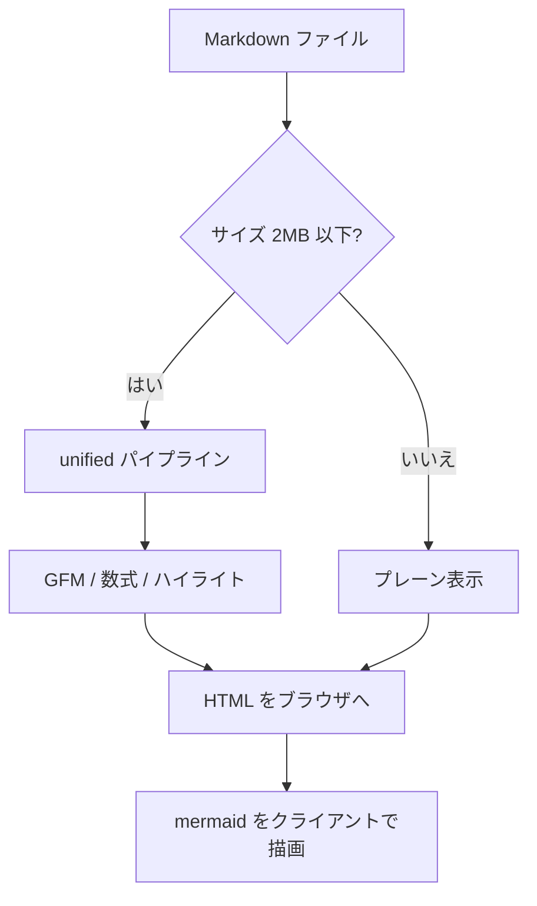
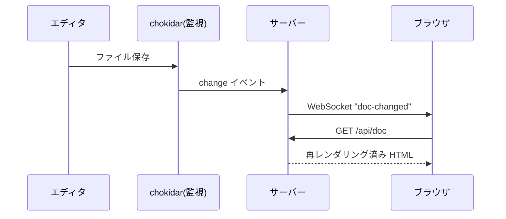
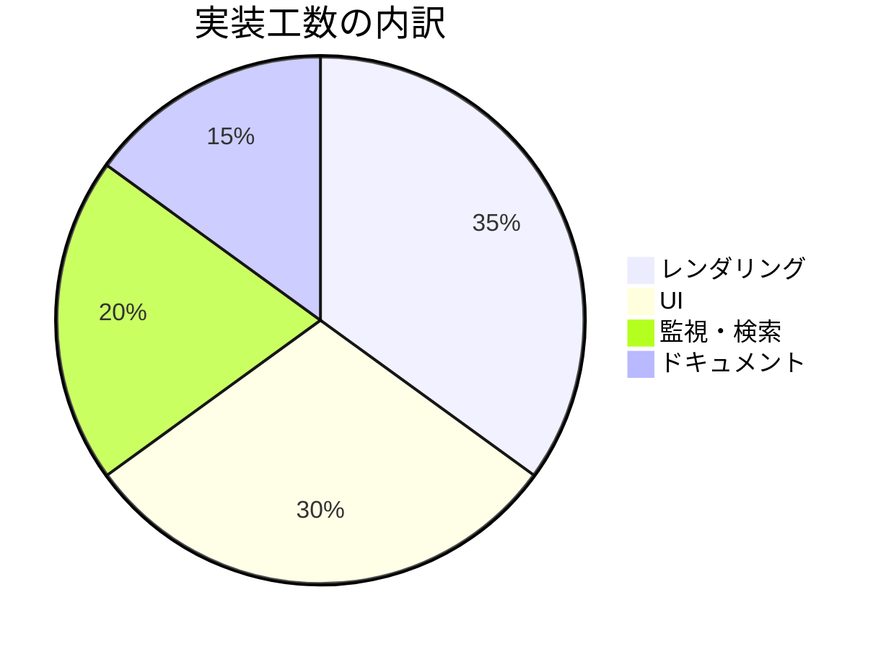

# Mermaid ダイアグラム

コードブロックに `mermaid` を指定すると図として描画されます。
テーマ切替(ライト/ダーク)にも追従します。

## フローチャート



## シーケンス図



## 円グラフ



## 構文エラーの扱い

構文が壊れている場合は、エラーメッセージと元ソースが表示されます(画面全体は壊れません):

```mermaid
flowchart TD
    A --> ここは不正な構文 --> --> B
```
